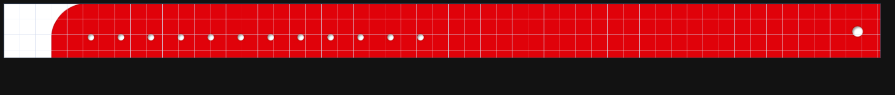

# Escala do fundo no editor de numerações

Alteração local restrita à referência de fundo no editor, em
`drawCanvasFace()` e `autoLoadCorBg()` de `frontend/script.js`.
Para fundos automáticos de cores com margens, usa `CorMargens.calcular()`:
a área da cor tem o tamanho cadastrado e a origem da peça fica nas margens
esquerda/superior. O fundo é desenhado com deslocamento negativo dessas
margens. A mesma regra é usada na frente e no verso.

Fundos próprios e cores sem margens usam medidas físicas do PDF ou pixels/DPI,
centralizados na mesma escala em milímetros dos elementos. O canvas recorta
o excedente. Imagens sem DPI usam 300 DPI, como a miniatura salva já fazia.
Medidas inválidas usam o tamanho do formato.

O carregamento da cor anexa margens somente ao objeto de imagem transitório
do editor. Fundos próprios não herdam essas margens.
Não foram modificados persistência, miniatura salva, Lista de
Arte, geração de PDF, impressão, posicionamento de elementos ou banco.
As mudanças anteriores do checkout operacional foram preservadas em outro
diretório; este trabalho parte de `3d4a5924` em worktree separado.

## Verificação com Pulseira Botão

Consulta somente de leitura em 13/11/2026 ao cadastro solicitado:

- Formato **Pulseira Botão**: 276 × 17,5 mm.
- Numeração genérica **Botão**: somente metadados, sem números visíveis.
- Fundo automático **Vermelha - Botão**, arquivo `Vermelha BOTAO 2027.pdf`.
- Página real do PDF: aproximadamente 286,004 × 45,043 mm.

As margens reais das cores foram consultadas: esquerda/direita/inferior de
5 mm e superior de 22,5 mm. Centralizar o PDF era incorreto para esse cadastro.
O PDF foi baixado e rasterizado localmente para o teste em Chromium. As funções
reais de carregamento automático e desenho do editor foram executadas com
os dados da cor e do formato, substituindo apenas o download e a rasterização
pela imagem local do mesmo PDF.
Resultado: área da cor 286 × 45 mm, origem (-5; -22,5) mm,
canvas 2000 × 127 pixels. O excedente fica fora da faixa de 17,5 mm e é
recortado; não há redução para mostrar a página inteira. Nenhuma alteração
foi salva na numeração real.

## Testes

O teste de regressão falha na base antiga: uma página 106 × 56 mm era
reduzida para 94,643 × 50 mm num formato 100 × 50 mm.
Na correção, testes em Chromium cobrem PDF no tamanho do formato, maior e
menor, DPI explícito, ausente e inválido, frente/verso, recorte, carregamento
das margens assimétricas e preservação das coordenadas de elementos sintéticos.
Também verifica que um fundo manual posterior não herda margens da cor.
A suíte focada passou: 9 testes.
Opacidade e visibilidade continuam independentes e foram verificadas.

Verificação dos dois canais repetida após a inclusão das margens:
`conferir_duas_versoes.py --base origin/main` concluiu as 40 etapas com
sucesso. Cada canal teve 912 testes aprovados, 2 ignorados e 2 subtestes,
além dos harnesses de navegador. O aviso de depreciação de httpx/Starlette
é preexistente; nenhuma dependência foi alterada. Sintaxe e diff conferidos.

O teste com o PDF real prova o desenho local, não publicação ou uso numa
estação. A publicação web deve ser comprovada separadamente, por PR,
deploy e comparação dos arquivos nos dois domínios públicos.
